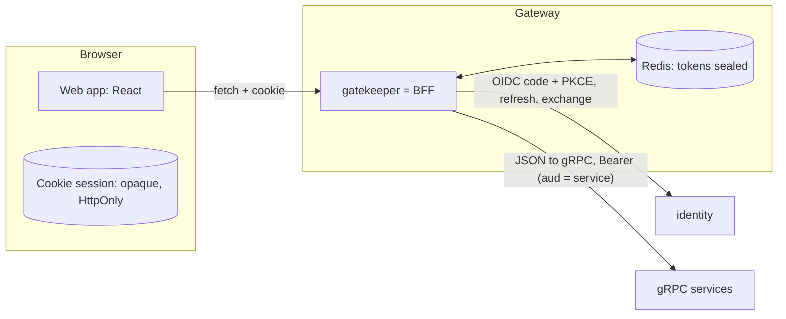

# The BFF in gatekeeper

BFF means **Backend For Frontend**: a server that sits between a web app and the backend and
does the OAuth work for it. In this platform the BFF is the gatekeeper. This document explains why
it exists, how it works, and what it asks from the web apps. For a request-by-request walk through see
[identity/docs/api-call-flow.md](../../identity/docs/api-call-flow.md), and for the identity side
[identity/docs/flows.md](../../identity/docs/flows.md).

## 1. The problem

A browser app that signs in with OAuth 2.0 gets an access token and a refresh token. Where does it keep them?

| Option | Problem |
| --- | --- |
| `localStorage` or `sessionStorage` | Any script that runs in the page (an XSS bug, a compromised npm package) can read and steal both tokens, and use them from anywhere. |
| JavaScript memory | Gone at every reload, and still readable by injected scripts. The refresh token would need the same place. |
| A cookie that holds the token | Large, sent to every route, and the token still travels to the browser. |

The recommendation of the OAuth working group for browser apps ("OAuth 2.0 for Browser-Based Apps")
is the BFF pattern: **the browser never holds a token**.

## 2. The idea

1. The gatekeeper is the **OAuth client** (a confidential client with a secret), not the web app.
2. After login it stores the tokens in Redis, and gives the browser a random cookie that is only a key.
3. The web app calls the gatekeeper with the cookie. The gatekeeper looks up the session, adds the right
   token and calls the service.
4. The browser sees JSON and a cookie. A stolen cookie value is useless to read, and the tokens
   cannot be taken from the page.

| | SPA with tokens in the browser | BFF (gatekeeper) |
| --- | --- | --- |
| Where the tokens are | Browser storage or memory | Redis on the server, sealed with AES-GCM |
| OAuth client | Public client (no secret) | Confidential client (has a secret) |
| XSS can steal a token | Yes | No (it can still make calls as the user, see 7) |
| Refresh token in the browser | Yes | No |
| Revoke a session | Hard (tokens are out) | Delete the Redis key |
| Extra hop | No | Yes (one gateway) |

## 3. What the gatekeeper does as a BFF

The BFF has four jobs. Each one has a file:

| Job | Code | Described in |
| --- | --- | --- |
| Run the login for the browser (code flow, PKCE, state, nonce) | `internal/bff/bff.go`: `login`, `callback` | [api-call-flow 4.2](../../identity/docs/api-call-flow.md) |
| Keep the session and the tokens | `internal/session/session.go` | section 4 below |
| Keep the tokens fresh (refresh, one replica at a time) | `bff.Server.refresh`, `session.Store.Lock` | [api-call-flow 3.3](../../identity/docs/api-call-flow.md) |
| Turn each request into an upstream call with the right token | `bff.Server.route`, `proxy`, `gocommon/tokenexchange` | [api-call-flow 3](../../identity/docs/api-call-flow.md) |

Two more jobs protect the browser side: CORS and CSRF (section 5), and logout, including the
back-channel logout that identity sends (section 6).

## 4. The session

### 4.1 Cookie

| Property | Value | Why |
| --- | --- | --- |
| Name | `__Host-session` (`session` on local http) | The `__Host-` prefix forces `Secure`, path `/` and no `Domain`: the cookie belongs to the gateway host only. |
| Value | 32 random bytes, base64url | An opaque key. It has no data and no signature to forge. |
| `HttpOnly` | yes | JavaScript cannot read it. |
| `Secure` | yes outside local http | Never sent over plain http. |
| `SameSite` | `Lax` | Not sent on cross-site POST requests. |
| Lifetime | session cookie (no `Max-Age`) | The real lifetime is on the server. |

A new id is created at every login, so a session id cannot be fixed by an attacker.

### 4.2 Redis

| Key | Content | TTL |
| --- | --- | --- |
| `gk:sess:<sha256(cookie)>` | The session, sealed (AES-256-GCM, key id in the prefix, AAD = the key hash) | Idle 8 h (`GATEKEEPER_SESSION_IDLE_TTL`), absolute 168 h (`GATEKEEPER_SESSION_ABSOLUTE_TTL`) |
| `gk:login:<sha256(state)>` | Nonce, PKCE verifier, `return_to` of a login in progress, sealed | 10 min, single use |
| `gk:sid:<identity sid>` | Set of session keys created from that identity session | Absolute TTL |
| `gk:sub:<user id>` | Set of all session keys of the user | Absolute TTL |
| `gk:lock:<sha256(cookie)>` | Refresh lock | 10 s |

The session holds `sub`, the identity session id (`sid`), the access token, the refresh token, the ID token,
the expiry of the access token, the CSRF token and the creation time (`session.Session`).

- The keys of Redis are hashes of the cookie, so a Redis dump does not give a usable cookie.
- The values are sealed, so a Redis dump alone does not give a token. The key is
  `GATEKEEPER_SESSION_KEY` (`id:base64(32 bytes)`, comma separated, the first one seals and all of them open,
  which allows rotation).
- Idle timeout slides at each use but never goes beyond the absolute lifetime.

### 4.3 What the browser can learn

Only `GET /auth/me`: `sub`, roles, scopes, permissions, `amr`, the expiry and the `csrf_token`. The tokens are never in a response.
Permissions are there so the UI can hide buttons. They are a hint: the gateway and the service check them again.

## 5. Protecting the browser calls

### 5.1 CORS

The web apps (`dict.example.com`, `bill.example.com`) and the gateway (`api.example.com`) are different origins.
`bff.Server.cors` answers only the origins of `GATEKEEPER_UI_ORIGINS`:

- `Access-Control-Allow-Origin: <that origin>` and `Access-Control-Allow-Credentials: true`. Never `*`, because credentials are used.
- Preflights (`OPTIONS`) are answered by the gateway before authentication, with methods `GET, POST, PUT, PATCH, DELETE`
  and headers `Content-Type, Csrf-Token, Authorization`.
- An unknown origin gets no CORS header and the browser blocks the answer.

The cookie is sent on these calls because the apps and the gateway are **same-site** (same registrable domain,
for example `example.com`), so `SameSite=Lax` does not stop it. This is why a new web app must share the registrable domain with the gateway.
The web app calls with `fetch(url, {credentials: "include"})`.

### 5.2 CSRF

A cookie is sent by the browser on its own, so another site could try to trigger a call.
For every method except `GET` the gatekeeper requires both (`bff.Server.checkWrite`):

1. `Origin` is one of the UI origins (a page of another site cannot forge it).
2. `Csrf-Token` equals the CSRF token of the session (from `/auth/me`; only a script of an allowed origin can read it), compared in constant time.

`SameSite=Lax` and the CORS allow list are two more layers. These checks are skipped for a Bearer call, because
there is no cookie to abuse.

### 5.3 Open redirect

`return_to` of `/auth/login` and `/auth/logout` goes through `safeReturn`: a path of the gateway, or an absolute URL whose origin is in
`GATEKEEPER_UI_ORIGINS`. Anything else is replaced by the default.

## 6. Login, logout and SSO

- **One login for all apps.** The gatekeeper has one session per browser and all the web apps use it.
  Identity also has its own SSO session. If the user is already signed in at identity, `/auth/login` returns at once
  without a form.
- **Logout** (`POST /auth/logout`): the session is deleted, the refresh token revoked, and the app moves the browser to the
  `logout_url` of identity, which ends the SSO session and returns to the app.
- **Back-channel logout** (`POST /auth/backchannel-logout`): when a session ends at identity for any reason (logout elsewhere, password
  reset, user disabled, MFA reset), identity sends a signed logout token. The gatekeeper deletes the sessions of that `sid`
  (or of that user) using the sets `gk:sid:` and `gk:sub:`. So a user cannot stay signed in at the gateway after identity ended the session.

## 7. The same code serves three kinds of callers

| Caller | Mode | Differences |
| --- | --- | --- |
| Web app | Cookie (BFF) | Session, refresh by the gateway, CORS, `Origin` and `Csrf-Token` on writes |
| Mobile app | Bearer | The app is its own public client with PKCE and refreshes its tokens. No session here |
| Service | Bearer | `client_credentials` for the audience of the gateway |

Any `Authorization` header selects Bearer mode, and a bad header is 401, never a fallback to the cookie.
Routes, permissions and token exchange are identical for all three. See `bff.Server.authenticate`.

## 8. The web side

The web apps use the package `web/packages/auth-client` (`createClient`, React hook `useAuth`). It does the browser half of the BFF:

| Function | What it does |
| --- | --- |
| `me()` | `GET /auth/me` with `credentials: "include"`. Cached. `null` on 401. |
| `login(returnTo)` | Navigates to `apiBase/auth/login?return_to=...`. Debounced for 3 s, so two calls do not overwrite the login state cookie. |
| `loginLooped()` | True when a login started less than 15 s ago and there is still no session (cookies blocked). Stops redirect loops. |
| `api(method, path, body)` | JSON call. Adds `Csrf-Token` on writes, retries once with a fresh token on `bad_csrf`, and starts the login on 401. Throws `ApiError` with the `code` of the gateway. |
| `logout()` | `POST /auth/logout`, then navigates to the returned `logout_url`. |

`API_BASE` (the gateway address) comes from `window.__env__` (`env.ts`), rendered into `config.js` by the `web-application` chart, so one image
serves every environment.

## 9. Security notes and limits

- **XSS can still call the API as the user.** The BFF stops token theft, not the use of the session while the page is open. An injected script
  can read `/auth/me`, take the CSRF token and call routes. Keep the CSP strict, and give users the smallest permissions.
- **The session is shared by all web apps.** A script injection in one app can call everything the user can do through the gateway. Same advice.
- **A revoked access token works until it expires** in Bearer mode (it is verified locally). In cookie mode the exchange asks identity, which refuses
  tokens issued before the user cutoff, so a disabled user is refused at once.
- **The gateway is a shared dependency.** If Redis is down, cookie sessions fail (503). If identity is down, new logins and refreshes fail, existing
  tokens keep working until they expire. `readyz` checks Redis.
- **Cookie scope.** The cookie belongs to the gateway host only (`__Host-`). The web apps never see it, they just send it with `credentials: "include"`.
- **Third-party cookie blocking.** It works because the apps and the gateway are same-site. A web app on an unrelated domain would not
  receive the cookie in the browsers that block third-party cookies. Keep the apps under the same registrable domain.

## 10. Why one shared BFF and not one per app

| One shared gateway (current) | One BFF per web app |
| --- | --- |
| One place for tokens, sessions, exchange and routes | Same code repeated per app |
| One login for all apps | Separate sessions, or extra SSO work |
| New app: add an origin and a post-logout URI, no deployment | New deployment per app |
| Larger blast radius if the gateway has a bug | Isolated |

## 11. How to extend

| I want to | Do |
| --- | --- |
| Add a web app | Add its origin to `GATEKEEPER_UI_ORIGINS` in `mm-deploy` and its URL as a post-logout URI of the `gatekeeper` client (`post_logout_uris` in the setup config of the identity Application, see the identity README). Use `auth-client` with `API_BASE`. |
| Expose a new gRPC method | Add a route with `permission` to `routes.yaml`; release the gatekeeper; the chart renders the ConfigMap. |
| Expose a new service | Add `routes.upstreams.<name>.target` in the chart values, routes in `routes.yaml`, and an exchange policy `gatekeeper -> <name>` (admin app, or `exchange_policies` of the identity setup config). |
| Support a mobile app | Create a public client in identity with `--resource gatekeeper` (README, "Adding a mobile app"). |
| Require MFA on every login | Set `GATEKEEPER_ACR_VALUES=mfa`. |
| Rotate the session key | Put a new `id:key` first in `GATEKEEPER_SESSION_KEY`, keep the old one after it until the sessions expire (168 h at most). |

## 12. Local development

See the gatekeeper `README.md` and `web/README.md`. In short: `make routes` writes `routes.local.yaml`, `.env.example` has the variables, and
the web e2e (`web/e2e/run.sh`) runs the login, a call and the logout against a local identity, Postgres and Redis.
